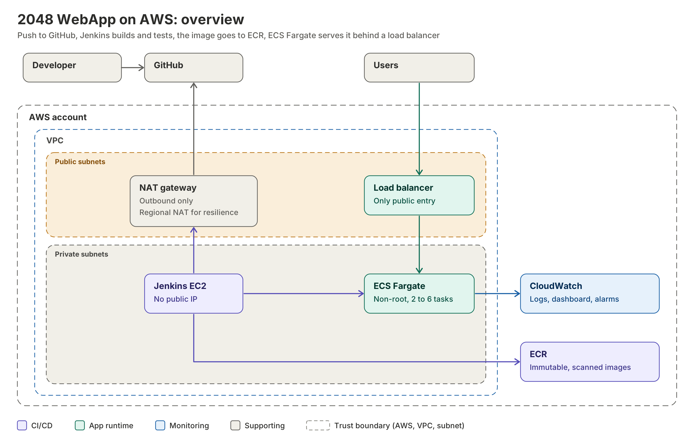
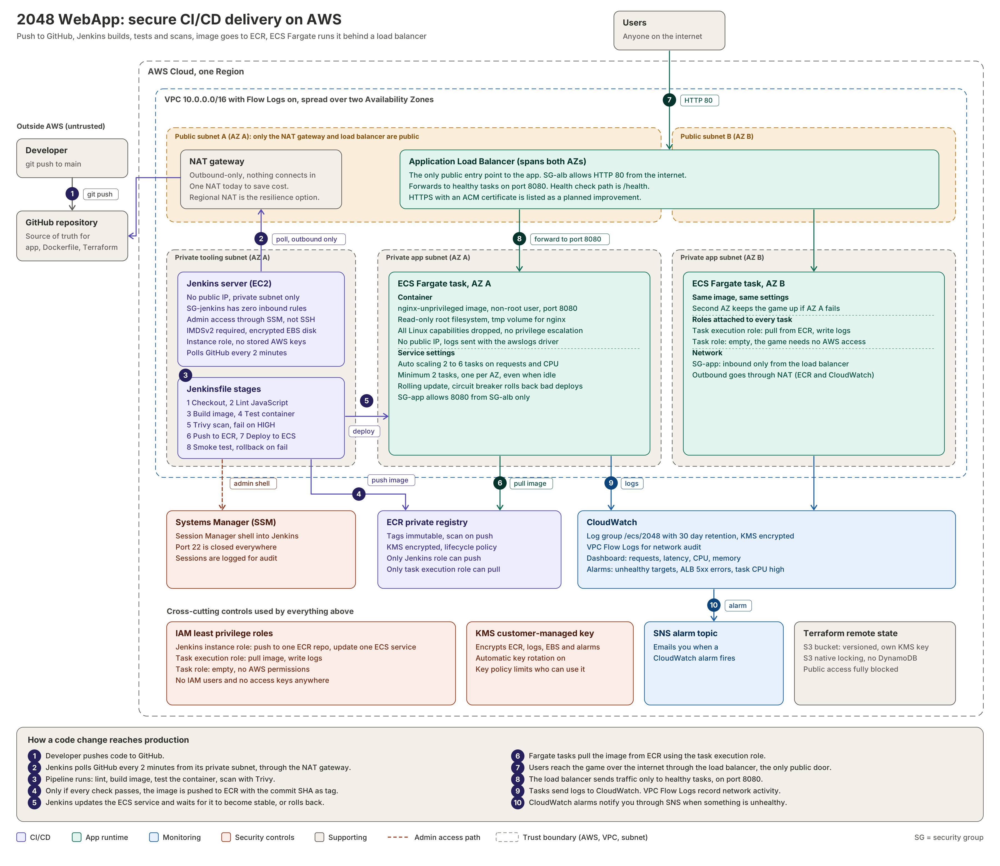
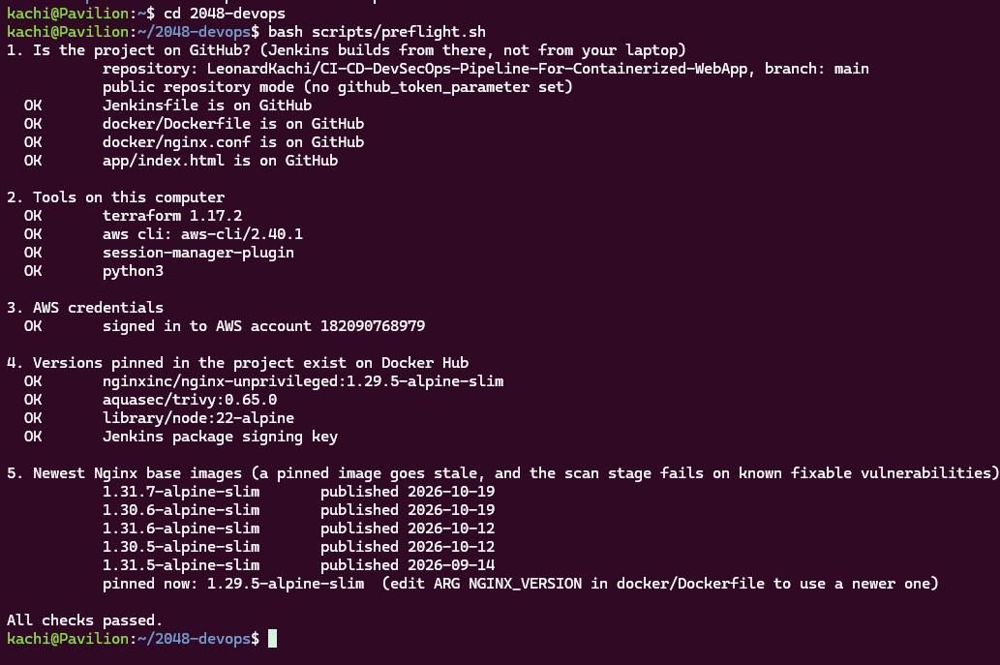
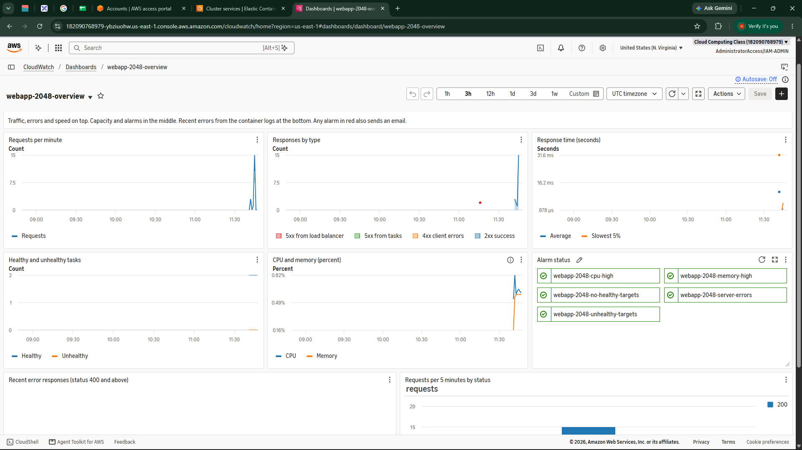
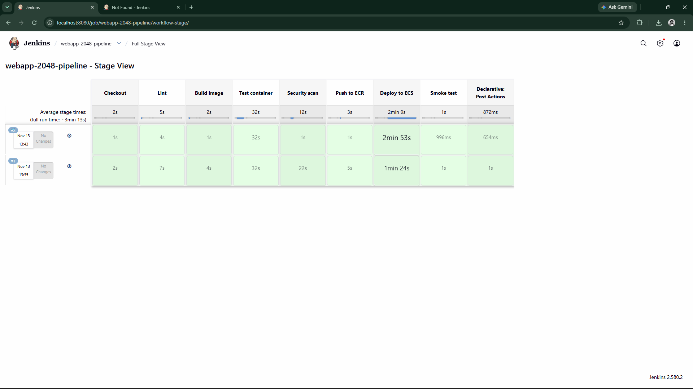
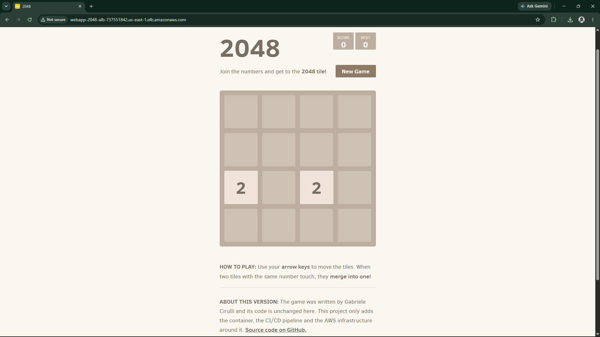

# Secure CI/CD pipeline for a containerized web app on AWS

A fully automated delivery pipeline. A `git push` is picked up by Jenkins, which lints, builds, tests and scans a hardened container image, stores it in a private registry, and deploys it to AWS Fargate behind a load balancer. All infrastructure is built with Terraform, and every decision is made with security in mind.

## Scope and credits

**The game is not my work.** The application is the open source 2048 game written by [Gabriele Cirulli](https://github.com/gabrielecirulli/2048), used under its MIT license (kept in [`app/LICENSE.txt`](app/LICENSE.txt)). The game code is used without changes, and it is an older snapshot of the upstream project. Nothing in this submission is about the game itself.

**What this submission is:** the containerization, the CI/CD pipeline and the AWS infrastructure built around the game.

| Part | Author |
|---|---|
| Game code (`app/js`, `app/style`, `app/meta`) | Gabriele Cirulli, MIT, unmodified |
| `app/index.html` | Original, with only the footer text and link attributes edited |
| `app/.jshintrc` | Original, with two scoped lint exceptions (see [Design decisions](#design-decisions)) |
| `docker/` (Dockerfile, Nginx config), `.dockerignore` | Obidiegwu Onyedikachi |
| `Jenkinsfile` | Obidiegwu Onyedikachi |
| `terraform/` (bootstrap and eight modules) | Obidiegwu Onyedikachi |
| `docs/`, `README.md` | Obidiegwu Onyedikachi |

## Overview



1. A developer pushes to GitHub.
2. Jenkins, running on a private server with no inbound access, detects the commit.
3. Jenkins builds the image, tests it with production restrictions, and scans it for vulnerabilities.
4. Only if every check passes, the image is pushed to ECR and deployed to ECS Fargate.
5. Users reach the game only through the load balancer, which is the single public entry point.
6. If the new version is unhealthy, the deployment rolls back automatically.

## How the pipeline works

The pipeline is defined in [`Jenkinsfile`](Jenkinsfile). Jenkins itself is created and configured by Terraform, including the pipeline job, so nobody clicks through a setup wizard.

**Trigger.** Jenkins has no public address, so GitHub cannot call it. Instead Jenkins polls GitHub about every 2 minutes. The repository is public, so no credentials are stored anywhere. Jenkins watches the `main` branch only.

| # | Stage | What it does | Why it exists |
|---|---|---|---|
| 1 | **Checkout** | Pulls the commit, checks that Jenkins has all five settings it needs, and derives the image tag from the commit ID. | Every image maps to exactly one commit. A missing setting fails immediately, not halfway through. |
| 2 | **Lint** | Runs JSHint in a throwaway Node container with the source mounted read-only. | Catches errors before a build is wasted. Nothing is installed on the Jenkins host. |
| 3 | **Build image** | Builds from `docker/Dockerfile` with a pinned base image and commit labels. | Repeatable builds. |
| 4 | **Test container** | Starts the image with the same restrictions as production (read-only filesystem, no Linux capabilities) and runs seven checks: health, home page, four security headers, no version leak, `POST` is refused, hidden files are refused, and the process runs as a non-root user. | Proves the hardened container works before it goes anywhere. If it cannot run restricted, it is found here, not in production. |
| 5 | **Security scan** | Scans the image with Trivy for vulnerabilities and embedded secrets. HIGH and CRITICAL findings that have a fix fail the build. A full JSON report is kept as a build artifact. | A vulnerable image never reaches the registry. The image is scanned from a file, so the scanner never gets the Docker socket. |
| 6 | **Push to ECR** | Only on `main`. Logs in with short-lived credentials kept in a temporary folder, then pushes the image tagged with the commit. If that commit was already pushed, it reuses the image. | Tags are immutable in ECR, so a tag always means the same bytes. Credentials are never left on disk. |
| 7 | **Deploy to ECS** | Registers a new task definition revision that changes only the image, updates the service, waits for it to stabilise, then confirms the service really runs the new version. | ECS reports "stable" even after rolling itself back, so the pipeline checks the outcome instead of trusting the status. |
| 8 | **Smoke test** | Calls the public load balancer for up to about 2.5 minutes: health endpoint, home page, security headers. | Tests the same path real users take. A failure triggers a rollback. |

**Failure handling**

- Any failure before stage 6 means nothing leaves Jenkins. The registry and the running service are untouched.
- Two safety nets work together at stage 7. ECS has a deployment circuit breaker that rolls back by itself if new tasks keep failing. If the deployment looks fine but the smoke test fails, the pipeline rolls back to the previous task definition and then fails the build.
- Builds never run at the same time, a build is stopped after 30 minutes, and Jenkins keeps the last 20.
- Only the `main` branch can push or deploy. The branch check in the Jenkinsfile is a second guard behind the job configuration.

## Architecture in detail

The full picture, with every security control written on the component it protects. The numbers follow one code change from push to production, and the panel at the bottom of the image explains each step. The vector version, which can be zoomed, is [`docs/architecture-detailed.svg`](docs/architecture-detailed.svg).



### Security at a glance

- **No public surface except the load balancer.** Jenkins and the containers live in private subnets with no public IPs.
- **No SSH, anywhere.** Port 22 is closed. Admin access to Jenkins goes through SSM Session Manager.
- **No stored AWS credentials.** Jenkins uses its instance role, scoped to one repository and one service. It can hand ECS only the application's own two roles.
- **Jenkins listens on localhost only,** behind a firewall with zero inbound rules. The server requires IMDSv2 with a hop limit of 1, so containers on it cannot reach the role credentials.
- **Hardened container.** Non-root user, read-only root filesystem, all Linux capabilities dropped, strict Content Security Policy, hidden server version.
- **Security groups form a chain,** and outbound traffic is restricted too: load balancer to app on 8080 only, app to HTTPS only, Jenkins to HTTPS and HTTP only.
- **Registry locks from two sides.** IAM, plus a repository policy: only the pipeline can push, and only the pipeline and the running service can pull.
- **Encryption.** One customer-managed KMS key (rotation on) covers ECR, logs, the Jenkins disk and the alarm topic. The Terraform state has its own key.
- **Audit trail.** VPC Flow Logs, load balancer access logs, container logs in structured JSON, and CloudTrail-visible key use.
- **No secrets in Git or Terraform state.** The Jenkins admin password is generated on the server and stored encrypted in SSM Parameter Store.

## Repository structure

```
.
├── app/                        the game (third party, see Scope and credits)
├── docker/
│   ├── Dockerfile              pinned, non-root, health-checked image
│   └── nginx.conf              security headers, JSON logs, /health
├── Jenkinsfile                 the 8-stage pipeline
├── terraform/
│   ├── bootstrap/              S3 state bucket and its KMS key (run once)
│   ├── main.tf  variables.tf  outputs.tf  versions.tf  providers.tf
│   ├── terraform.tfvars.example   backend.hcl.example
│   └── modules/
│       ├── kms/                encryption key
│       ├── network/            VPC, subnets, NAT, routes, Flow Logs
│       ├── security/           security groups
│       ├── ecr/                registry, lifecycle, access policy
│       ├── alb/                load balancer, target group, access logs
│       ├── ecs/                cluster, task, service, IAM roles, auto scaling
│       ├── monitoring/         dashboard, alarms, alert topic
│       └── jenkins/            CI/CD server, its role, first-boot setup
├── scripts/
│   ├── preflight.sh            checks everything before you spend money on AWS
│   └── jenkins.sh              open Jenkins, read the password, run diagnostics
├── docs/                       architecture diagrams and deployment screenshots
├── .dockerignore  .gitignore  .gitattributes  LICENSE
```

## Design decisions

Each decision lists what was chosen, why, and the honest tradeoff.

### 1. Fargate with auto scaling between 2 and 6 tasks

Fargate is serverless for the infrastructure: AWS provides and patches the capacity, and there are no servers to manage. It does not decide how many tasks to run, so that is configured here.

- **Minimum 2:** one task per Availability Zone, so losing a zone does not take the site down, even when idle.
- **Maximum 6:** a cost ceiling. Without one, a traffic flood or attack scales into a large bill.
- **Signals:** requests per task is the main one, because a static Nginx site uses very little CPU. CPU at 60% is the safety net. Scaling out is quick (60 s cooldown) and scaling in is slow (300 s), so the count does not flap.
- **Tradeoff:** a sudden spike still has a short delay while new tasks start. For a static site that serves very little work per request, this is mostly a demonstration of the mechanism.

### 2. Jenkins in a private subnet, reached outbound only

- **Chosen:** Jenkins calls out to GitHub through the NAT gateway and polls for changes. Admin access is an SSM tunnel.
- **Rejected:** a public webhook endpoint into Jenkins, which would give the internet a way to reach the CI server.
- **Why:** with no inbound rules at all, there is nothing to attack from the internet.
- **Tradeoff:** a build starts up to about 2 minutes after a push. A public, HTTPS-protected webhook limited to GitHub's published IP ranges is the instant-trigger alternative.
- **Private repositories** are supported with a read-only, single-repository token held in SSM. The token is the only credential the server holds, so it should be short-lived.

### 3. The load balancer serves HTTP only, for now

- **Why:** HTTPS needs a certificate and a domain record, which adds setup that is outside the core of this challenge. The limitation is stated here and in the code.
- **Plan:** an ACM certificate and an HTTPS listener, with port 80 becoming a redirect, then the `Strict-Transport-Security` header. Jenkins is not affected, because it accepts no inbound connections.
- **Tradeoff:** traffic between users and the load balancer is not encrypted today. The game carries no personal data.

### 4. One NAT gateway

- **Why:** cost. One gateway in Availability Zone A.
- **Tradeoff:** it is a single point of failure. If that zone fails, running tasks keep serving users, but new deployments and image pulls fail until it recovers.
- **Resilience option:** a regional NAT gateway, or one NAT gateway per zone.

### 5. Test and scan before push, push before deploy, tag with the commit

Bad images are stopped before they reach the registry, so they can never be deployed by accident, by someone else, or by a later pipeline. Immutable tags mean "what is running" always traces back to one commit, and rollbacks go to an image that still exists.

### 6. The scan gate fails on HIGH and CRITICAL findings with a fix

A gate that fails on problems nobody can fix gets switched off. Findings without an available fix are still in the archived JSON report. The ECR scan on push is a second opinion.

### 7. Outbound traffic is restricted by port

Open outbound access is how stolen access sends data out or downloads tools. Containers may only call HTTPS, which is all they need to pull images and write logs. Jenkins gets HTTPS, plus HTTP for the smoke test.

- **Limit:** this controls ports, not destinations. Controlling destinations needs VPC endpoints with endpoint policies, or a network firewall (see Improvements).

### 8. Two locks on the registry

IAM limits what roles can do, and the repository policy limits it again from the repository side, with explicit denies. Even a person or role with broad ECR permissions cannot push a tampered image. Management actions are not denied, so an administrator can never be locked out.

### 9. Terraform state with native S3 locking

The state bucket is private, versioned, encrypted with its own key, and only reachable over HTTPS. Locking uses S3 itself. DynamoDB locking is deprecated, so this uses one component less. It needs Terraform 1.11 or newer. The bucket details are passed at init time and stay out of Git.

### 10. Jenkins is configured as code

Jenkins Configuration as Code sets security, settings and the pipeline job on first boot. The installer for plugins is downloaded from a pinned release and checked against a SHA-256 checksum before it runs. The admin password is generated on the server and stored encrypted in SSM.

- **Tradeoff:** plugin versions are not pinned, so two builds of the server months apart could differ.

### 11. Player progress

The game already saves the best score and the game in progress in the browser's local storage. That needs no backend, no login and no personal data. Saving progress across devices would need an API, a database and a login (for example DynamoDB and Cognito) with HTTPS, which is a much larger attack surface. It is left as a documented roadmap, not built.

### 12. Two lint exceptions, scoped to their files

The original JSHint rules flag the game's polyfill (it extends a built-in prototype, as polyfills do) and one function nested one level too deep. Both exceptions are scoped to those two files in `app/.jshintrc`, so the same rules still apply everywhere else. The JavaScript itself was not changed.

### 13. `allow_teardown`

A variable that defaults to true. It lets `terraform destroy` remove images and logs and shortens the key deletion wait, so a reviewer's cleanup does not get stuck. Set it to false for real use: it keeps images and logs and turns on load balancer deletion protection.

## Deploying it

**Prerequisites**

- An AWS account and credentials that can create IAM roles, KMS keys, VPC resources, ECS, ECR, EC2 and CloudWatch resources (administrator-level for a first deployment)
- [Terraform](https://developer.hashicorp.com/terraform/install) 1.11 or newer
- [AWS CLI v2](https://docs.aws.amazon.com/cli/latest/userguide/getting-started-install.html) and the [Session Manager plugin](https://docs.aws.amazon.com/systems-manager/latest/userguide/session-manager-working-with-install-plugin.html), for the Jenkins tunnel
- This repository pushed to GitHub, on the `main` branch. Jenkins reads it from the URL in `github_repo_url` (default: `LeonardKachi/CI-CD-DevSecOps-Pipeline-For-Containerized-WebApp`). If you use your own copy, set that variable. The repository must be public, or you must follow the private repository steps below.

**Private repository (optional)**

Jenkins reads the repository without a password, which works only for a public repository. For a private one, give Jenkins a read-only token:

1. On GitHub, open Settings, Developer settings, Personal access tokens, Fine-grained tokens, and generate a token. Choose **Only select repositories** and pick this repository. Under repository permissions, set **Contents** to **Read-only**. Pick an expiry that outlasts your evaluation, because Jenkins stops polling when the token expires.
2. Store the token in SSM before you run Terraform. `read -rs` keeps it out of your shell history:

```bash
read -rs TOKEN
aws ssm put-parameter --name /webapp-2048/github-token --type SecureString --value "$TOKEN" --region us-east-1
unset TOKEN
```

3. In `terraform/terraform.tfvars`, add `github_token_parameter = "/webapp-2048/github-token"`.

The Jenkins server reads that one parameter on first boot and keeps the token in its encrypted credential store. The Jenkins role may read only that parameter. `bash scripts/preflight.sh` then checks the token against GitHub.

**0. Check before you start**

```bash
bash scripts/preflight.sh
```

It confirms that the project is on GitHub (Jenkins builds from there, not from your computer), that the tools and AWS credentials work, and that every version pinned in the project exists. If it reports a problem, fix it first.

**1. Create the state bucket (once)**

```bash
cd terraform/bootstrap
terraform init
terraform apply
terraform output -raw backend_config > ../backend.hcl
```

On Windows PowerShell, use `terraform output -raw backend_config | Out-File -Encoding ascii ../backend.hcl` instead. A plain `>` there writes UTF-16, which Terraform cannot read.

**2. Build the infrastructure**

```bash
cd ..
cp terraform.tfvars.example terraform.tfvars      # optional, the defaults work
terraform init -backend-config=backend.hcl
terraform apply
```

Terraform asks for `alert_email`. Use your real address: placeholder addresses are rejected. Commit the generated `.terraform.lock.hcl` files, which pin the provider versions.

**3. After apply finishes**

`terraform output next_steps` prints this list:

1. Click the AWS confirmation link in your email, or no alarm will reach you.
2. Wait about 10 minutes for Jenkins to finish its first-boot setup.
3. Run `bash scripts/jenkins.sh tunnel`, browse to `http://localhost:8080`, and log in as `admin`. `bash scripts/jenkins.sh password` prints the password. Run these on your own computer, not inside the server shell.

   On Windows PowerShell, where the script is not available, the quoted JSON gets mangled. Use a file instead:

   ```powershell
   '{"portNumber":["8080"],"localPortNumber":["8080"]}' | Out-File -Encoding ascii tunnel.json
   aws ssm start-session --target (terraform output -raw jenkins_instance_id) --document-name AWS-StartPortForwardingSession --parameters file://tunnel.json --region us-east-1
   ```
4. Jenkins checks GitHub every 2 minutes and starts the first build by itself. The first build pushes the image and deploys it. If nothing seems to happen, run `bash scripts/jenkins.sh doctor`: it prints the Jenkins boot log, whether it found the repository and the Jenkinsfile, and the console of the newest build.

5. When the build is green, open the `app_url` output.

**Expected on first apply.** The ECS service exists but cannot start tasks until the first pipeline run has pushed an image, so the site returns 503 until then. This is the reason the pipeline, not Terraform, performs the first deployment.

**4. See the pipeline work**

Change any text in `app/index.html`, push to `main`, and watch Jenkins start a new build within a couple of minutes. The new image is tagged with the commit and rolled out without downtime. The CloudWatch dashboard (`dashboard_url` output) shows traffic, errors, capacity and alarms.

**5. Tear down**

```bash
cd terraform
terraform destroy
aws ssm delete-parameter --name /webapp-2048/jenkins/admin-password --region us-east-1
```

The Jenkins admin password parameter is created by the server, not by Terraform, so it is removed by hand. If you used a private repository, also delete the token parameter (`/webapp-2048/github-token`) and revoke the token on GitHub. The state bucket in `terraform/bootstrap` has `prevent_destroy` on purpose. To remove it as well, delete that setting first and destroy it.

Billed resources include the NAT gateway, the load balancer, the Fargate tasks and the Jenkins server. Destroy the stack when finished.

### Troubleshooting

| Symptom | Where to look |
|---|---|
| Nothing in ECR, no build, or the build fails immediately | Almost always: the project is not on the `main` branch of the repository in `github_repo_url`, or the repository is private and no token is configured, so Jenkins finds no Jenkinsfile. Run `bash scripts/preflight.sh`, then `bash scripts/jenkins.sh doctor` |
| The scan stage fails | The pinned Nginx base image has gone stale. Read the Trivy table in the build log. `bash scripts/preflight.sh` lists the newest base image tags. Update `ARG NGINX_VERSION` in `docker/Dockerfile` and push |
| Jenkins does not appear after about 10 minutes | Shell on the server (`jenkins_shell_command`), then `/var/log/jenkins-bootstrap.log` and `journalctl -u jenkins` |
| Site returns 503 | Expected until the first build finishes. After that, check the ECS service events and the application log group |
| Tasks stop right after starting, with a `/tmp` permission error | The helper container that prepares `/tmp` in the task definition (`modules/ecs/main.tf`) |
| Manual `docker push` is denied | Intended. Only the pipeline role may push. Delete the repository policy to override in an emergency |
| No alarm emails | The subscription is still pending: click the confirmation link |

## Verification status

**Checks run during development**

- The Nginx configuration was run as a non-root user against the game files: headers, health endpoint, blocked methods, hidden files, gzip, caching and JSON logging all behave as designed.
- Every shell script in the Jenkinsfile passes a syntax check. The test stage, smoke test and push logic were exercised against the real Nginx configuration with stand-ins for Docker and AWS, including cases that must fail (a missing header, a leaked version, running as root, an existing image tag).
- The task definition rewrite was tested on a realistic sample: only the images change.
- Every AWS call in the Jenkinsfile was matched to an IAM permission on the Jenkins role, with no wildcard actions.
- The Jenkins first-boot script was rendered offline: valid bash, within the size limit, and the generated Jenkins configuration is valid and contains all five settings the pipeline needs.
- All Terraform is correctly formatted and syntactically valid. Every module call supplies its required inputs, and the dependency graph has no circular dependencies.
- The dashboard definition was evaluated and its layout checked.

**Verified in a real AWS account (us-east-1)**

- The bootstrap stack (9 resources) and the main stack (68 resources) applied with no errors and no warnings.
- A shell on the Jenkins server opened through SSM Session Manager, with no SSH and no inbound rules. Docker, Git, jq, Java and Jenkins were installed by the boot script.
- The Jenkins role was refused actions outside its job (starting sessions and deleting the password parameter), as designed.
- `terraform destroy` removed all 68 resources cleanly.

### Evidence from a real deployment

Screenshots from the AWS console, taken after `terraform apply` in us-east-1.

| What it shows | Screenshot |
|---|---|
| The **preflight validation script** confirming that the GitHub repository, required project files, Terraform, AWS CLI, Session Manager plugin, AWS credentials, Docker Hub images, and Jenkins signing key are all available and passing checks |  |
| The private registry `webapp-2048` with **immutable tags** and **KMS encryption** |  |
| The **lifecycle policy**: untagged images removed after 1 day, only the newest 10 kept |  |
| The **two explicit deny statements** that lock push and pull to the pipeline and the running service |  |
| The **Jenkins server**: no public IP, private tooling subnet, IMDSv2 required, dedicated role |  |
| The **internet-facing load balancer**, active across two Availability Zones |  |
| The **CloudWatch dashboard** showing application traffic, response status, response times, ECS task health, CPU and memory usage, and alarm status |  |
| The **Jenkins CI/CD pipeline** showing all eight stages successfully completed, from checkout and security scanning to ECS deployment and smoke testing |  |
| The **Amazon ECR image repository** showing the successfully pushed container image, image tag, digest, and vulnerability scan results |  |
| The **Amazon ECS cluster** showing the active service, Fargate launch type, and two running tasks |  |
| The **deployed 2048 web application** running successfully through the internet-facing Application Load Balancer |  |

<!--
More evidence to add. Save each screenshot in docs/, then move its row into the
table above.

| The **CloudWatch dashboard**: traffic, response codes, response time, healthy tasks, CPU and memory, alarm status |  |
| The **Jenkins pipeline**: all eight stages green |  |
| The **image in ECR**, tagged with the commit ID |  |
| The **ECS service**: two tasks running, one per Availability Zone |  |
| The **game running** in the browser through the load balancer |  |
| A **second build** after a change, deployed without downtime |  |
-->

## Known limitations and improvements

- **HTTPS** on the load balancer (see decision 3).
- **Regional or per-zone NAT** for resilience (decision 4).
- **AWS WAF** in front of the load balancer for rate limiting and managed rules.
- **Destination-level egress control** with VPC endpoints and endpoint policies, or AWS Network Firewall (decision 7).
- **Network ACLs** as an extra layer. They are stateless and easy to get wrong, so the security groups are the main control here.
- **Pin Jenkins plugin versions**, and pin the base image by digest.
- **Amazon Inspector enhanced scanning** for continuous vulnerability scanning in ECR.
- **Jenkins backup:** the server is rebuilt from code, but job history lives on its disk. Scheduled EBS snapshots would protect it.
- **Accepted risk:** the Jenkins user can run Docker, which is root-equivalent on that server. This is why the server is isolated, with no inbound access and a minimal role.
- **State bucket access logging** and a stricter deployer role than administrator.
- The game is an older snapshot of the upstream project and does not include its later fixes. This does not affect the pipeline.

## Credits and license

- The 2048 game: Gabriele Cirulli, MIT license ([`app/LICENSE.txt`](app/LICENSE.txt)). Based on [1024 by Veewo Studio](https://itunes.apple.com/us/app/1024!/id823499224) and conceptually similar to [Threes by Asher Vollmer](http://asherv.com/threes/).
- Everything else in this repository: MIT license ([`LICENSE`](LICENSE)).
